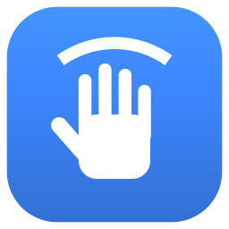

# Vibe Hand

Фоновое приложение для Windows 11 на C++20: камера ноутбука следит за рукой и лицом,
жесты выполняют действия на ПК. Живёт в трее рядом с часами, почти не тратит энергию.
Сделано под **Lenovo Legion 7 15ASH11** (Ryzen AI Max+ 392, Radeon 8060S, 64 ГБ,
камера 5 Мп + ИК Windows Hello со шторкой).

<p align="center"></p>

## Возможности

- **Жесты настраиваются прямо в приложении.** Правило = жест + удержание + кулдаун + рука +
  кто может подавать жест + действие. Есть 11 статических поз (ладонь, кулак,
  указательный, V, три пальца, большой палец вверх/вниз, OK, щипок, «коза», «позвони»)
  движения одной рукой (4 взмаха и «помахать») и 4 жеста двумя руками.
  Поза сглаживается по трём последним кадрам, так что одна ошибка кадра не сбивает удержание.
- **Свои жесты.** При записи выбираются три настройки, под каждой есть описание с примерами.
  - **Тип.**
    - **Статичный** — знак без движения или с микродвижениями: палец вверх, кулак, ладонь,
      «коза», «Chinema» двумя руками. Одна или две руки определяются по записи.
      В образцы идут только кадры, где рука стояла.
    - **Динамичный** — движение рукой определённой формы. По записи определяется, что это:
      **туда-обратно** (покачивание, тряска кулаком, «колодец» к камере и обратно — оси
      X, Y или глубина, размах и частота берутся из записи) или **рывок** в одну сторону
      (быстро туда, медленно обратно, как взмах кулаком вправо).
      Срабатывает только поза вместе с движением.
  - **Образцы**: компактно (24) — простые чёткие знаки, узнаёт строже; стандарт (48) — подходит
    большинству жестов; подробно (96) — сложные формы, разные ракурсы, динамичные жесты.
  - **Время записи**: 6–12 с, рекомендованный диапазон показывается для выбранного типа.
    Перед записью идёт отсчёт 2 с, чтобы не попадали кадры, пока вы ставите руку. Рядом с
    настройками записи показывается камера: рука, обе руки, отсчёт и прогресс.

  «Заново» перезаписывает жест с текущими настройками. После записи показывается, что
  распознано, сколько образцов и насколько ровно держалась поза. Отдельно предупреждается,
  если жест похож на другой ваш жест или на встроенный из включённого правила.
  Форма руки описывается в 3D в системе координат ладони плюс её ориентация к камере:
  не ломается, когда кисть повёрнута торцом, и не зависит от расстояния. Порог берётся из
  разброса самой записи, ползунок «строже — мягче» его сдвигает. Свой жест должен держаться
  2 кадра из 3. Записи до 0.3 (2D-силуэт) работают, но помечены «нажмите „Заново“».- **Меньше ложных срабатываний.**
  - У позы есть «серая зона»: наполовину согнутый палец не даёт ни «прямого», ни «согнутого».
  - «V», «три пальца» и «ладонь» засчитываются, только если пальцы смотрят вверх.
  - Статичный жест не срабатывает, пока рука движется, видна не целиком или модель в ней не уверена.
  - Две руки рядом друг с другом считаются занятыми (телефон, клавиатура): одноручные позы
    с них не берутся.
  - Поза должна держаться 2 кадра из 3.
  - Встроенные жесты можно выключать по одному: на странице «Жесты» → «Встроенные жесты».
- **Лицо не обязательно.** Требовать ли лицо в кадре, знакомое лицо или взгляд на экран,
  выбирается в каждом правиле. Если ни одно правило этого не требует, модель лиц не запускается вовсе.
- **Камера доступна другим приложениям.** Vibe Hand читает камеру в совместном режиме Windows
  (Frame Server) и не захватывает её: Discord, Teams и «Камера» работают одновременно с ним.
  Аппаратные настройки камеры (усиление в темноте, ИК-подсветка) в этом режиме остаются
  за управляющим приложением, программное ночное усиление работает как раньше.- **Движения.**
  - Взмахи влево, вправо, вверх и вниз. Взмах засчитывается, если ладонь открыта бо́льшую часть
    движения: смазанный кадр посреди взмаха его не отменяет. Если рука вылетела за кадр,
    взмах тоже засчитывается. Через ~0,2 с взмах подтверждается: если рука сразу пошла обратно,
    это помахивание, а не взмах. Работает и при ~8 к/с, то есть в тёмной комнате.
    Серия взмахов в одну сторону работает: обратный ход руки в течение 0,9 с не считается
    встречным взмахом. Задержка ~0,2 с включается, только если есть правило с «помахать»
    или своим жестом с движением, иначе взмах срабатывает сразу.
  - «Помахать рукой»: 3 смены направления за 1,6 с с похожей скоростью в обе стороны.
    Серия быстрых взмахов с медленным возвратом за помахивание не считается.
  - Правила «Взмах влево/вправо → предыдущее/следующее окно» уже лежат выключенными.
    Окна перебираются по кругу без панели Alt+Tab.
- **Две руки.** Отслеживаются обе руки сразу. Жесты: «Две ладони», «Два кулака»,
  «Развести руки» и «Свести руки». Для двух последних есть выключенные примеры
  «→ увеличить / уменьшить масштаб» (Ctrl + / Ctrl −). Пока в кадре две руки,
  взмахи одной рукой не считаются: разведение рук иначе читалось бы как два взмаха.- **Действия.** У каждого есть описание прямо в редакторе правила: что нажимается и где полезно.
  - Любое приложение из меню «Пуск», включая приложения Microsoft Store, или любой файл, папка
    или ссылка.
  - Любое сочетание клавиш.
  - Окна: следующее/предыдущее, Alt+Tab, свернуть, развернуть, закрыть, представление задач,
    рабочий стол, виртуальные рабочие столы.
  - Медиа, громкость, прокрутка, назад/вперёд в браузере.
  - «Микрофон вкл/выкл» выключает сами микрофоны в Windows: вас не слышит ни одно приложение,
    включая Discord (значок в Discord при этом не меняется, на экране показывается, выключен
    микрофон или включён). «Микрофон в звонке (Win+Alt+K)» — для Teams и приложений,
    поддерживающих выключение микрофона в звонке Windows 11.
  - Снимок области или всего экрана, «Пуск», поиск, проводник, блокировка ПК, масштаб.
- **Лица.** Можно добавить себя и других. Запоминание длится ~12 секунд (снимок каждые 0,3 с,
  повторы отбрасываются). «Дописать» добавляет ещё 8 секунд, например ночью с ИК-камеры.
  Правило может требовать «любое лицо в кадре», «любое знакомое» или «только Анна»,
  а также «смотрю на экран». Хранятся только 128-мерные векторы, зашифрованные DPAPI.
  Фотографии не сохраняются.
- **Ночное зрение.**
  1. Программное усиление: адаптивная гамма, CLAHE и шумоподавление, которое не размывает движение.
  2. Аппаратное: в темноте поднимаются усиление и компенсация подсветки камеры.
  3. **ИК-камера Windows Hello** с подсветкой и вычитанием засветки (если сенсор чередует
     кадры с подсветкой и без). В режиме «Авто» всё включается само.
- **Мало энергии.**
  - Три темпа работы: 30 к/с, пока рука в кадре; 4 к/с в ожидании; 1 к/с, когда никого нет.
  - Пока рука в кадре, её ведёт трекер, а детектор ладони не запускается.
  - Включён EcoQoS (Windows сажает поток на экономичные частоты), а пул потоков ONNX Runtime
    не крутится вхолостую.
  - Камера полностью отпускается (индикатор гаснет) при блокировке ПК, выключенном экране,
    в полноэкранной игре или презентации и на паузе. Видео на весь экран (YouTube в браузере,
    плееры, Discord, Zoom) паузу не включает: управлять жестами во время просмотра можно.
  - На батарее автоматически включается режим «Эко».
- **Нативная интеграция.**
  - Значок у часов: щелчок открывает панель быстрых настроек в стиле Windows 11,
    правый щелчок — меню.
  - Глобальные горячие клавиши.
  - Автозапуск в трей. Повторный запуск открывает окно уже работающей копии.
  - При срабатывании жеста появляется подсказка над панелью задач, при удержании — кольцо прогресса.
- **Интерфейс.**
  - Direct2D, Mica, скругления, Segoe UI Variable и Segoe Fluent Icons.
  - Тёмная и светлая тема, акцент Windows или пресеты (включая Legion Blue).
  - Окно настроек при закрытии уничтожается, а не прячется, чтобы освободить память.

## Сборка (Windows 11, Visual Studio 2026 или 2022)

```powershell
git clone -b claude/vibe-legion-gesture-app-7n9xat https://github.com/edikdr/Vibe-stuck-
cd Vibe-stuck-\vibe-legion
powershell -ExecutionPolicy Bypass -File scripts\fetch-deps.ps1   # ONNX Runtime + модели (SHA-256)
cmake --preset windows-release
cmake --build --preset windows-release
build\release\Release\VibeHand.exe
```

Нужен компонент «Разработка классических приложений на C++» (CMake входит в него). Команды выполняются
в **Developer PowerShell for VS**. Пресет `windows-release` рассчитан на Visual Studio 2026; для VS 2022
используйте `cmake --preset windows-release-vs2022` и `cmake --build --preset windows-release-vs2022`.

Пресет VS 2026 отключает FileTracker MSBuild (`TrackFileAccess=false`). На VS 2026 Insiders 18.12
(MSVC 14.52) задача `CL` падала с `MSB4018: IndexOutOfRangeException в FileTracker.FileIsUnderNormalizedPath`
даже на пустом проекте, и CMake не мог определить компилятор. Цена обхода: каждая сборка полная (~20 с).
Рядом с exe автоматически кладутся `onnxruntime.dll` и папка `models\`. Для переноса на
другой ПК достаточно папки `build\release\Release` (или `cmake --install`).

Варианты:

| Что | Как |
|---|---|
| Нейросети на Radeon 8060S (DirectML) | `fetch-deps.ps1 -Flavor directml`, затем `cmake --preset windows-directml` |
| ONNX Runtime из vcpkg вместо готового архива | `cmake --preset windows-vcpkg` (нужен `VCPKG_ROOT`; сборка ORT в vcpkg долгая) |
| NPU XDNA 2 | ONNX Runtime из Ryzen AI SDK (VitisAI EP) в `third_party\onnxruntime`; в приложении «Питание → Где считать → NPU». Путь к `vaip_config.json` задаётся переменной `VL_VITISAI_CONFIG` |

Если выбранное устройство недоступно, приложение само откатывается на процессор.
Для этих моделей процессор и так самый экономичный вариант, подробнее в [docs/ARCHITECTURE.md](docs/ARCHITECTURE.md).

## Первый запуск

1. Откроется окно «Обзор», значок появится у часов. В Windows 11 он может оказаться под «^»:
   *Система → Значок рядом с часами → Параметры панели задач* → включите Vibe Hand.
2. **Камера и ночь**: проверьте, что картинка есть. Если в «Обзоре» правая рука подписана
   как левая, включите «Поменять левую и правую руку».
3. **Лица** (по желанию): «Добавить и запомнить» и ~12 секунд медленно поворачивайте голову.
   Ночью стоит дописать образцы ещё раз: ИК-камера даёт отдельные отпечатки.
4. **Жесты**: примеры «Ладонь → пауза/play» и «Взмах влево/вправо → предыдущее/следующее окно»
   уже лежат выключенными. Включите их или создайте своё правило. Строка «Сейчас вижу»
   и подсказка «Первое правило: другой жест / нет лица / …» помогают подобрать параметры.

Данные из старой папки `%LOCALAPPDATA%\VibeLegion\` (так приложение называлось до 0.2)
при первом запуске копируются в новую. Запись автозапуска обновляется при каждом старте.

Горячие клавиши по умолчанию: `Ctrl+Alt+G` ставит распознавание на паузу и снимает с неё,
`Ctrl+Alt+V` открывает окно. Обе меняются в разделе «Система».

Данные лежат в `%LOCALAPPDATA%\VibeHand\`: `settings.json` (обычный JSON) и `faces.bin` (DPAPI).

## Ресурсы (замеры на Legion 7, 0.2)

Замер в Windows на этом ноутбуке. Сцена живая (человек в кадре, без руки), окно закрыто.
Время стадий взято со страницы «Питание», нагрузка процесса — по `TotalProcessorTime`
за 45 с. Окончательные цифры стоит перепроверить в Диспетчере задач.

| | |
|---|---|
| Кисть (трекинг, 224×224), на руку | ~6 мс |
| Детектор ладони (192×192): пока руки нет, а при одной руке раз в 250 мс (ищет вторую) | ~8,5 мс |
| Лицо YuNet на 224×128 | ~0,8 мс |
| Узнавание SFace **fp32** (знакомое лицо раз в 1 с, незнакомое раз в 0,6 с) | ~15 мс |
| То же, SFace int8 (было до 0.2) | ~110 мс |
| Средняя нагрузка в ожидании (8 к/с) | ~0,8 % от 24 потоков (~20 % одного ядра) |
| Пик за 1 с | до ~3,8 % от 24 потоков |
| Приватная память | ~105 МБ (было ~50: веса fp32 SFace — 38 МБ) |

Сравнение с версией до этих изменений в тех же условиях: средняя нагрузка 0,8–0,95 %, пик
2,1–3,8 %. Старая версия запускала SFace int8 на каждом кадре, пока лицо не узнано. Теперь
при бо́льшей работе (8 к/с в ожидании вместо 4, поиск второй руки, две руки) нагрузка не выше
прежней. С двумя руками частота ограничена 2/3 от активной (30 → 20 к/с), чтобы пик рос
не больше чем на ~30 %. Int8-модели кисти и SFace на Zen 5 медленнее fp32 (в 4 и 7 раз),
поэтому по умолчанию выключены.
## Структура

```
src/core/      переносимое ядро: изображения, ночное зрение, декодеры моделей,
               жесты, свои жесты и правила, база лиц, настройки (JSON)
src/ml/        ONNX Runtime: сессии, выбор CPU/DirectML/NPU, 4 модели
src/vision/    конвейер: адаптивная частота, трекинг, лица, задачи (запись, калибровка)
src/platform/win/  Media Foundation (камера + ИК), трей, питание, DPAPI, автозапуск
src/ui/        Direct2D: виджеты Fluent, окно, страницы, панель у трея, OSD
src/app/       App (связывает всё), действия через SendInput, wWinMain
tests/         юнит-тесты ядра + vl_selftest (модели на реальных картинках)
scripts/       fetch-deps.ps1, make_icon.py
```

## Тесты

```bash
cmake -S . -B build -DVL_ORT_ROOT=<onnxruntime> && cmake --build build
build/vl_tests                                    # 170 проверок ядра, на любой ОС
build/vl_selftest models img1.ppm img2.ppm        # модели на картинках (PPM)
```

## Что проверено, а что нет

Проверено при разработке:
- юнит-тесты ядра;
- модели на реальных фотографиях рук и лиц (поза, лево/право, трекинг, лица, эмбеддинги);
- полный конвейер с правилом;
- сборка Windows-приложения (MinGW-w64, кросс-компиляция);
- запуск и отрисовка всех страниц и панели у трея под Wine (без камеры и без шрифта
  Fluent Icons, поэтому на скриншотах вместо значков квадраты).

**Не проверено на реальном железе:**
- сборка MSVC;
- захват с камеры Legion и поведение ИК-сенсора и его подсветки;
- DirectML и NPU;
- фактические цифры CPU и памяти в Windows;
- отрисовка Mica.

Это первое, что стоит посмотреть при запуске на ноутбуке.

## Лицензии моделей

MediaPipe Palm Detection / Hand Landmark — Apache-2.0 (Google), YuNet — MIT, SFace — Apache-2.0;
все в составе [OpenCV Zoo](https://github.com/opencv/opencv_zoo). ONNX Runtime — MIT.
Всё работает локально, в сеть ничего не отправляется.
